# Sentiment Classification of Online Clothing Reviews: A Ten-Model Comparison on Sparse and Dense Text Features

**Author(s):** [Name], [Department], [Institution], [City, Country], [email]

---

## Abstract

Online clothing stores collect thousands of reviews, and reading them by hand
is not practical. This paper tests how well machine learning can judge a review
as positive or negative from its text alone. We use a public dataset of 23,486
women's clothing reviews. Three-star reviews were removed as unreliable: only
41.41% of those buyers recommended the product. Of the 19,813 reviews left,
88.04% are positive, so always answering "positive" already scores 88.02% on the
test set. Accuracy is therefore misleading, and macro-F1 is our main measure.
Ten classifiers were tested: logistic regression, linear SVM, multinomial naive
Bayes, k-nearest neighbours, random forest, extra trees, XGBoost, LightGBM,
CatBoost and a multilayer perceptron. Each was trained on sparse TF-IDF features
and a 300-component SVD projection, then tuned with Optuna over 184 trials.
Logistic regression won with 95.39% accuracy, macro-F1 0.8951, MCC 0.7914,
ROC-AUC 0.9755 and 85.67% recall on the rare negative class.

**Index Terms** — class imbalance, e-commerce reviews, macro-F1, Matthews
correlation coefficient, neutral class removal, sentiment classification,
TF-IDF, truncated SVD.

---

## I. Introduction

Buying clothes online has one obvious weakness. The customer cannot touch the
fabric, cannot try the item on, and cannot judge whether the colour in the photo
matches the colour that will arrive. Everything the customer knows before paying
comes from a picture, a size chart, and what earlier buyers have written. This
makes written reviews far more important for clothing than for a product whose
quality is easy to state in numbers. A phone has a screen size and a battery
capacity. A dress has a fit, a feel, and a way it hangs, and those things get
described in sentences rather than specifications.

The result is that clothing retailers end up sitting on a large pile of text.
A mid-sized store can collect tens of thousands of reviews in a year, and a large
one collects that many in a month. Somebody at the company needs to know what is
in that pile. Which items are disappointing buyers? Which complaints repeat?
Is a particular product line getting worse? Reading every review by hand answers
those questions, but no team is large enough to do it, and by the time a person
has read six months of reviews the season has already changed.

Sentiment classification is the usual way around this. The idea is simple: teach
a computer to read a review and put it in one of two boxes, positive or negative.
Once that works, the store can count the boxes instead of reading the text. It
can watch the negative share of a product week by week, raise an alert when that
share jumps, and send the flagged reviews to a human who then reads only a few
hundred instead of a few hundred thousand. The value is not that the machine
understands clothing. The value is that it sorts the pile so a person can spend
their attention where it matters.

A fair question at this point is why a model is needed at all when the customer
already gave a star rating. The rating is right there in the database, so
predicting it looks circular. There are two answers. The first is that plenty of
customer text arrives with no rating attached: support emails, live-chat
transcripts, social media posts, comments under a product photo, and returns
forms. A model trained where ratings exist can be pointed at text where they do
not. The second answer is that the rating and the text do not always agree, and
the disagreement is itself useful. A customer who gives four stars and then
writes a paragraph about the seams coming apart is telling the store something
the number hides.

Machine learning fits this task well because the input is cheap and already
stored. No new data collection is needed. The only real work is turning words
into numbers a model can handle, and there are well-tested ways of doing that.
The standard approach counts which words and character patterns appear in each
review, weights them so that common words count for less, and hands the result to
a classifier. This has been the backbone of text classification for years and it
still performs strongly on review data of this size.

There is a complication that shows up early and shapes everything after it. Most
reviews are good ones. People who like a purchase are more willing to write about
it, and returns tend to be handled through the returns process rather than
through a review. In the dataset used here, 88.04% of usable reviews are positive
after cleaning. This is not a small detail to be mentioned and moved past. It
changes what every reported number means.

The specific danger is that accuracy stops being informative. A model that reads
nothing, learns nothing, and simply answers "positive" every single time scores
88.02% accuracy on our test set. That number looks like a working system. It is
not one. Such a model finds zero negative reviews, which is the entire reason the
store wanted the system. Any paper that reports "we achieved 88% accuracy"
without printing the baseline next to it has reported nothing at all, and this is
common enough in applied work that it deserves stating plainly rather than
politely.

A second complication is the middle of the rating scale. Three-star reviews sit
between the two classes and do not clearly belong to either. We can check this
rather than assume it, because the dataset also records whether each customer
recommended the product. Among three-star reviewers, 41.41% recommended it and
58.59% did not, which is close to a coin toss. Compare that with one-star
reviews, where 98.10% did not recommend, and five-star reviews, where 99.81% did.
Three-star reviews are not a weak signal. They are a mixed signal, and training a
two-class model on them teaches it contradictions. We remove them, and we treat
that removal as a decision to be justified with evidence rather than a cleaning
step to be hidden in a footnote.

This paper compares ten classifiers on the cleaned data. They cover five
families: linear models, a probabilistic model, bagged tree ensembles, gradient
boosting machines, and a neural network, plus one instance-based method. Every
model is fed one of two feature views. Three models take the sparse TF-IDF matrix
of 96,755 features directly. The other seven take a dense 300-component truncated
SVD projection of that same matrix, because tree-based methods and distance-based
methods cannot work efficiently on a matrix that wide. All ten are tuned with
Optuna against validation macro-F1, tested once on a held-out set of 2,972
reviews, and compared against each other with McNemar's test under a
Holm-Bonferroni correction. Two dummy classifiers are carried through the whole
pipeline as controls.

The contributions are as follows. We show that removing the ambiguous neutral
class is worth 4.4 accuracy points and can be defended with a measured number
rather than convention. We show that on text of this size a tuned linear model
beats three modern boosting libraries and a neural network, which runs against
the usual expectation. We show that the sparse feature view outperforms the dense
projection, and we quantify why: 300 components retain only 29.61% of the
variance. We report every result against a stated baseline and lead with macro-F1
and MCC rather than accuracy. The rest of the paper is organised as follows.
Section II reviews related work. Section III describes the method. Section IV
explains each technology used. Section V defines the evaluation metrics.
Section VI reports results. Sections VII to X give discussion, limitations,
conclusions and future work.

---

## II. Related Work

### A. Sentiment analysis of product reviews

Deciding whether a piece of writing is positive or negative is one of the oldest
tasks in applied natural language processing. Early work on film reviews
established the basic recipe still used today: split the text into small units,
count them, weight the counts, and fit a linear classifier. Later work moved to
word embeddings and then to transformer models, which now hold the best published
scores on standard benchmarks. Those gains come at a cost in hardware. A
fine-tuned transformer needs a graphics card and hours of training, while the
approach used in this paper trains in seconds on an ordinary laptop processor.
For a retailer wanting a system that can be retrained weekly on a normal server,
that difference matters more than the last two points of accuracy.

### B. Machine learning on e-commerce datasets

Two studies supplied the comparison points for this work, both built on the
Brazilian Olist dataset. Pandey et al. [1] predicted customer satisfaction and
compared six methods. Their LSTM reached 87.09%, followed by XGBoost at 85.36%,
naive Bayes at 84.64%, a neural network at 83.97%, random forest at 83.34% and
logistic regression at 81.22%. Debbagh et al. [2] worked on the same source data
but treated the problem as demand forecasting rather than classification,
reporting a mean squared error of 0.0045 and a root mean squared error of 0.0067.
Neither study removed a neutral class, and neither reported a majority baseline
next to its accuracy figures, which makes their headline numbers hard to place.
The present paper differs on both points.

### C. Feature representation for short text

TF-IDF remains the default representation for classical text classifiers. Two
refinements matter for review data. The first is including word bigrams, which
capture short phrases whose meaning is not the sum of their parts; "not
flattering" is the clear example, since both words are harmless alone. The
second is character n-grams, which survive spelling mistakes, informal spellings
and word endings that a word-level vocabulary would miss. Reviews are written
quickly on phones and contain plenty of both. We use word and character features
together for this reason.

### D. Class imbalance and the choice of metric

When one class dominates, accuracy tracks the majority class and hides failure on
the minority. The literature on this is settled. Macro-averaged F1 gives each
class equal weight regardless of size. The Matthews correlation coefficient
summarises all four cells of the confusion matrix in one number and only rises
when the model does well on both classes at once. Several authors have argued MCC
is the most honest single figure for imbalanced binary problems. We follow that
advice, and we also print the majority baseline beside every table.

### E. Gap addressed by this work

Published comparisons of many classifiers on review data usually share three
weaknesses. They report accuracy first, they keep the ambiguous middle of the
rating scale without testing whether it helps, and they do not check whether the
gaps between models are larger than random variation. This paper addresses all
three. The neutral removal is backed by a measured recommendation rate, macro-F1
and MCC lead every table, and all 45 model pairs are tested for significance with
a correction for multiple comparisons.

---

## III. Proposed Method

### A. Dataset Used

The data is the *Women's E-Commerce Clothing Reviews* collection, released
publicly on Kaggle by the user `nicapotato`. It holds 23,486 reviews written by
real customers of a United States clothing retailer, anonymised so that no
customer or brand can be identified. There are ten columns. `Clothing ID` is an
item number, `Age` is the reviewer's age in years, `Title` is the short headline
a customer types above their review, `Review Text` is the review body,
`Rating` is the star score from 1 to 5, `Recommended IND` is a flag saying
whether the customer would recommend the item, `Positive Feedback Count` records
how many other shoppers found the review helpful, and `Division Name`,
`Department Name` and `Class Name` describe where the item sits in the store's
catalogue. Ratings are skewed towards the top of the scale: 13,131 reviews give
five stars, 5,077 give four, 2,871 give three, 1,565 give two and 842 give one.
The text fields are the useful part and the rest is context. `Review Text` is
missing in 845 rows and `Title` is missing in 3,810. There are 21 duplicated
rows. Table I lists the columns and how each is used, and Fig. 2 shows the rating
distribution.

**TABLE I. DATASET COLUMNS AND THEIR ROLE**

| Column | Type | Role in this study |
|---|---|---|
| Clothing ID | integer | Dropped; risks item-level memorisation |
| Age | integer | Context only; checked in EDA |
| Title | text | **Input**, joined to the review body |
| Review Text | text | **Input**, the main signal |
| Rating | integer 1–5 | **Source of the target label** |
| Recommended IND | binary | Used as evidence for neutral removal |
| Positive Feedback Count | integer | Context only; written after purchase |
| Division Name | category | Context only |
| Department Name | category | Context only |
| Class Name | category | Context only |

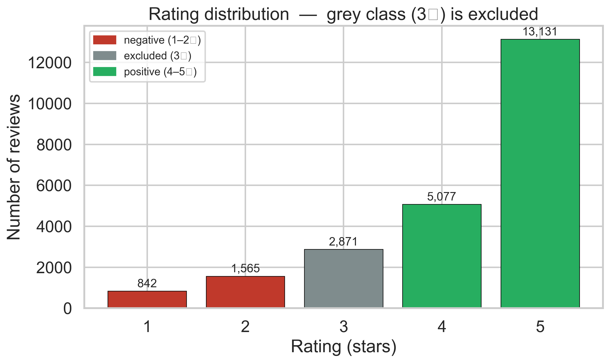

**Fig. 2.** Rating distribution across all 23,486 reviews. Five-star reviews
alone make up 55.91% of the data.

### B. Data Preprocessing

Preprocessing runs in four steps and each one is recorded. First, the 845 rows
with an empty review body are dropped, since a text classifier has nothing to
work with when there is no text; rows with a missing `Title` are kept and the
title is replaced with an empty string, because the body alone is still usable.
Second, the title and the body are joined into one field with a single space
between them, which lets short headlines like "Runs small" contribute to the
prediction instead of being thrown away. Third, all 2,823 reviews rated three
stars are removed for the reason given in Section I and measured in Table III.
Fourth, five reviews whose joined text is an exact duplicate of an earlier review
are removed; if left in, the same sentence could appear in both the training and
the test set and inflate the score. The binary target is then built by mapping
ratings of 4 and 5 to positive and ratings of 1 and 2 to negative. No stemming,
lemmatisation or stop-word removal is applied, because sublinear TF-IDF weighting
already suppresses common words and because negation words such as "not" carry
real meaning here and are routinely deleted by stop-word lists. Table II shows
the row count after each step. Fig. 3 gives the evidence for the neutral removal
and Fig. 4 shows the class balance that results.

**TABLE II. CLEANING LOG**

| Stage | Rows remaining | Rows removed |
|---|---|---|
| Raw file | 23,486 | 0 |
| Empty review text removed | 22,641 | 845 |
| Rating = 3 removed | 19,818 | 2,823 |
| Duplicate texts removed | 19,813 | 5 |

**TABLE III. RECOMMENDATION RATE BY STAR RATING**

| Rating | Did not recommend | Recommended | n | Share of data |
|---|---|---|---|---|
| 1 | 98.10% | 1.90% | 842 | 3.59% |
| 2 | 93.99% | 6.01% | 1,565 | 6.66% |
| **3** | **58.59%** | **41.41%** | **2,871** | **12.22%** |
| 4 | 3.31% | 96.69% | 5,077 | 21.62% |
| 5 | 0.19% | 99.81% | 13,131 | 55.91% |

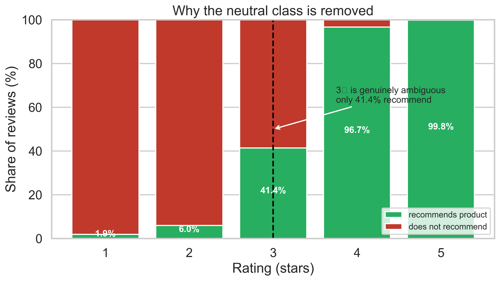

**Fig. 3.** Recommendation rate at each star level. One-star and five-star
reviewers are almost unanimous. Three-star reviewers split near 40/60, which is
why they are removed.

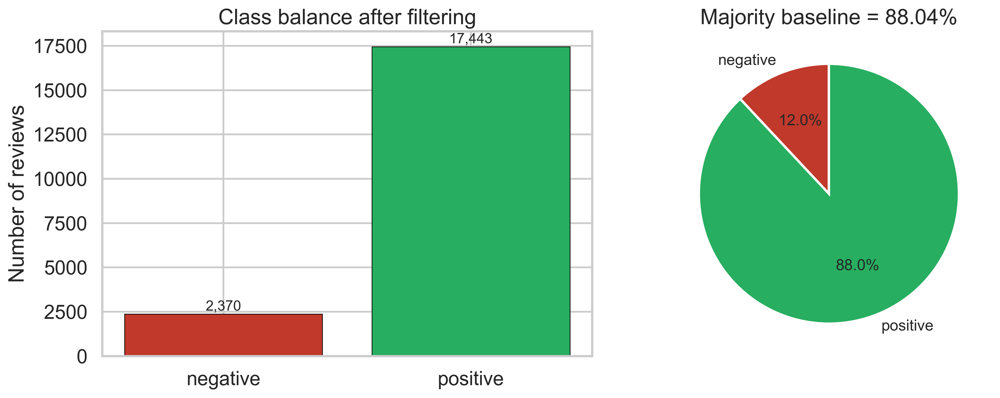

**Fig. 4.** Class balance after cleaning. 17,443 reviews are positive (88.04%)
and 2,370 are negative (11.96%).

### C. Data Splitting

The 19,813 cleaned reviews are divided into three parts: 13,869 for training
(70%), 2,972 for validation (15%) and 2,972 for testing (15%). The split is
stratified, which means the share of positive reviews is held almost constant
across the three parts at 88.04%, 88.06% and 88.02%. Stratification matters
because the negative class is small; an ordinary random split could easily hand
one set several dozen more negative reviews than another, and the reported
numbers would then move around from run to run for no real reason. A fixed random
seed of 42 makes the split reproducible. The three sets have separate jobs and
were never mixed. The training set fits the models. The validation set chooses
hyperparameters and nothing else. The test set is touched exactly once, at the
very end, to produce every number in Section VI. The test set contains 2,616
positive and 356 negative reviews, and that count of 356 is the figure to keep in
mind when reading the confusion matrices, since it is the small number that all
the interesting errors come out of. Table IV gives the split.

**TABLE IV. STRATIFIED 70/15/15 SPLIT**

| Split | n | Positive | Negative | Positive rate |
|---|---|---|---|---|
| Train | 13,869 | 12,210 | 1,659 | 88.04% |
| Validation | 2,972 | 2,617 | 355 | 88.06% |
| Test | 2,972 | 2,616 | 356 | 88.02% |

### D. Model Workflow

The workflow runs in one direction from the raw file to the final comparison, and
Fig. 1 draws it. The CSV is downloaded through `kagglehub` so that no manual
upload is involved and the source is fixed. The cleaning steps of Section III-B
are applied and logged. The cleaned data is split as in Section III-C, and that
split is then frozen for the rest of the study. Two feature views are built from
the training text only. The first is a sparse TF-IDF matrix combining word
n-grams of length one and two with character n-grams of length three to five,
giving 96,755 columns. The second is a dense matrix produced by projecting that
same TF-IDF matrix down to 300 components with truncated SVD and then
standardising the result. The vectorisers and the SVD are fitted on the training
split alone and then applied unchanged to validation and test, so no information
from the evaluation data reaches the training stage. Each model is then trained
twice: once with sensible default settings, and once with hyperparameters chosen
by Optuna against validation macro-F1. The tuned models are scored once on the
test set. Finally the ten models are compared with each other using McNemar's
test on their test predictions, the p-values are corrected with the
Holm-Bonferroni procedure, and the coefficients of the best linear model are
extracted for interpretation. Two dummy classifiers, one always predicting the
majority class and one predicting at random in proportion to the class rates, run
through the same evaluation code so that every metric has a floor to sit on.

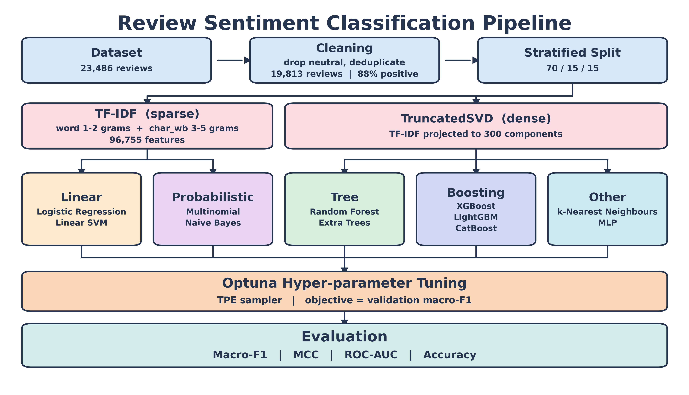

**Fig. 1.** Model workflow. Three models consume the sparse TF-IDF matrix
directly; the other seven consume a 300-component SVD projection of it.

### E. Correlation Matrix

Before modelling we measured the linear correlation between the numeric columns
and the target, which sets a realistic expectation for what the non-text features
could contribute. The outcome is one-sided. The target correlates at 0.910 with
`Rating` and at 0.930 with `Recommended IND`, but both of those are simply
restatements of the label rather than independent predictors, since the target
was derived from the rating and the recommendation flag is the same judgement
recorded a second time. `Rating` and `Recommended IND` correlate with each other
at 0.865 for the same reason. Every genuine feature is close to useless on its
own: `Age` correlates with sentiment at 0.013, `Positive Feedback Count` at
−0.057, and review length in words at −0.019. The picture holds when the same
variables are examined by group. The average negative review runs 63.98 words
against 62.26 for positive ones, a gap of under two words. Reviewers of negative
items average 42.99 years old against 43.50 for positive ones. Across
departments the positive rate moves only between 87.19% for Dresses and 90.26%
for Bottoms, with the single exception of the small Trend department at 78.79%
on 99 reviews, which is too few to lean on. The conclusion drawn from this
section is that the metadata carries almost no signal and the text carries all of
it, which is why the models in this paper are trained on text alone. Fig. 5,
Fig. 6 and Fig. 7 show these relationships.

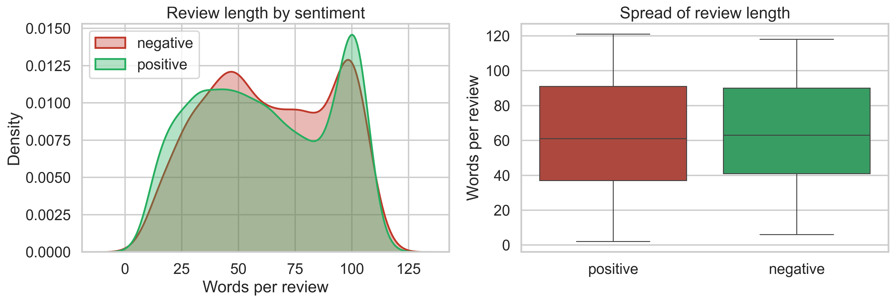

**Fig. 5.** Review length by sentiment. The two distributions sit almost on top
of each other.

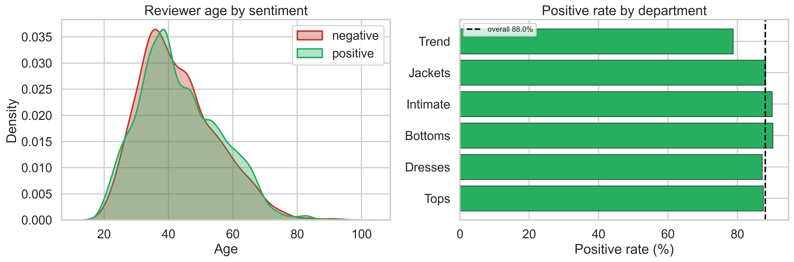

**Fig. 6.** Reviewer age and positive rate by department. Neither separates the
classes.

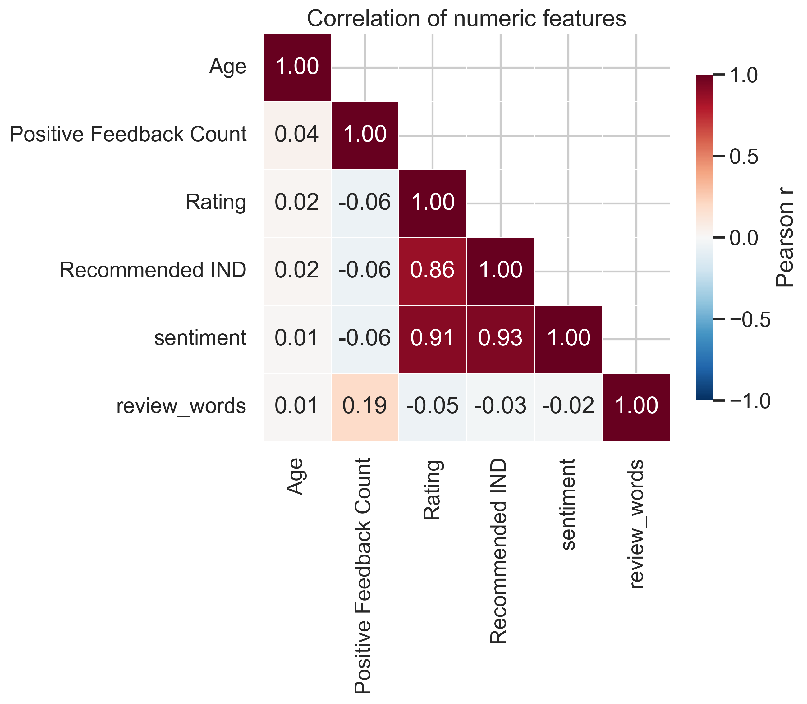

**Fig. 7.** Correlation matrix of the numeric columns. The only strong values
involve `Rating` and `Recommended IND`, which are restatements of the label.

---

## IV. Technology Used

### A. TF-IDF Vectorisation

TF-IDF converts each review into a long row of numbers. Term frequency counts how
often a token appears in a review, and inverse document frequency divides that by
how common the token is across the whole collection, so a word appearing in every
review counts for very little while a rare word counts for a lot. We build two
vectorisers and join their outputs. The word vectoriser uses unigrams and
bigrams, ignores anything appearing in fewer than two documents, and caps the
vocabulary at 50,000 features. Bigrams are the important part; "not flattering"
and "runs small" are phrases whose meaning collapses if the words are split. The
character vectoriser uses `char_wb` mode with n-grams of length three to five, a
minimum document frequency of three, and the same 50,000-feature cap. Character
features handle the misspellings and stretched words ("loooove") that appear
constantly in review text. Both use sublinear term frequency, which replaces the
raw count with one plus its logarithm so that a word repeated ten times does not
count ten times as much. The combined matrix has 96,755 columns and is 99.9%
zeros, which is why sparse storage is used.

### B. Truncated SVD

Seven of the ten models cannot work on a 96,755-column matrix. Decision trees
would have to test every column at every split, k-nearest neighbours would
compute distances in a space where almost every coordinate is zero, and the
neural network would need tens of millions of input weights. Truncated SVD solves
this by finding the 300 directions along which the reviews differ most and
describing each review by its position along those 300 directions instead. Unlike
ordinary PCA it works directly on a sparse matrix without centring it, which
matters at this width. The output is standardised afterwards so that all 300
columns share a scale. The cost is information: the 300 components retain 29.61%
of the original variance, so roughly seven tenths of the detail is discarded.
Section VI shows this cost turning up in the results as a one to three point
accuracy penalty for every model on the dense view.

### C. Logistic Regression

Logistic regression is the simplest classifier here and it turned out to be the
best. It gives every feature a weight, adds up the weighted values for a review,
and squashes the total through a logistic curve to get a probability between zero
and one. It suits sparse text for a structural reason: with 96,755 features and
13,869 training rows, the classes are almost always separable by a flat boundary,
and a flat boundary is exactly what this model draws. It also has the practical
advantage that its weights can be read directly, which Section VI-G uses. Optuna
searched the inverse regularisation strength C between 0.05 and 50 on a
logarithmic scale, and whether to weight the classes inversely to their
frequency. The best trial used **C = 8.034 with `class_weight = balanced`**, and
the solver ran to a maximum of 3,000 iterations. **Result:** accuracy 95.39%,
macro-F1 0.8951, MCC 0.7914, negative-class recall 0.8567. First on every metric
except ROC-AUC, and it fits in 2.15 seconds.

### D. Linear Support Vector Machine

The linear SVM also draws a flat boundary, but it picks the one that leaves the
widest empty margin between the two classes. Only the reviews closest to the
boundary affect where it goes, so distant points cannot drag it around, and that
tends to make it steadier than logistic regression when the data is noisy. A
linear kernel was chosen over a radial one because kernel methods scale badly at
this feature width. The base implementation returns distances rather than
probabilities, and probabilities are needed for the ROC and precision-recall
curves, so the classifier is wrapped in `CalibratedClassifierCV` with three-fold
internal cross-validation to convert its outputs. Optuna searched C between 0.01
and 10 and the class weighting, settling on **C = 0.233 with `class_weight =
None`**. **Result:** accuracy 95.02%, macro-F1 0.8781, MCC 0.7568, and the
highest ROC-AUC in the study at 0.9762. Its negative recall of 0.7556 is a full
ten points below logistic regression, which is what pushes it into second place.

### E. Multinomial Naive Bayes

Multinomial naive Bayes treats a review as a bag of tokens and asks which class
was more likely to have produced that bag. It assumes every token is independent
of every other one, which is plainly untrue for language, yet the model works
well anyway because the assumption mostly damages its probability estimates
rather than the ranking of the two classes. It was included as the classical
baseline for text classification and because it is extremely fast. The only
hyperparameter worth tuning is the additive smoothing constant alpha, which
decides how much probability mass is reserved for tokens never seen with a given
class; Optuna searched it between 0.005 and 3.0 on a log scale and chose
**alpha = 0.0273**. **Result:** accuracy 94.25%, macro-F1 0.8676, MCC 0.7357,
negative recall 0.7949, all in a fit time of 0.06 seconds. It is the only model
whose tuning made it slightly worse than its default settings.

### F. k-Nearest Neighbours

k-nearest neighbours stores the training set and classifies a new review by
finding the reviews most similar to it and taking a vote. It has no training
phase at all. It was included as a deliberate contrast, because it makes no
assumption about the shape of the boundary, and because a method that fails on
this data tells us something about the data. It runs on the SVD view, since
distances in a 96,755-dimensional sparse space are nearly meaningless. Optuna
searched the neighbour count from 5 to 75, the vote weighting, and the distance
measure, choosing **10 neighbours, uniform weights and cosine distance**.
**Result:** accuracy 91.18%, macro-F1 0.7474, MCC 0.5163, negative recall 0.4382.
It is last on every metric, and its 91.18% accuracy against an 88.02% baseline is
the clearest example in this study of a high accuracy hiding a weak model.

### G. Random Forest

A random forest grows many decision trees, each on a random sample of rows and
considering a random subset of features at every split, then averages their
votes. The randomness is the point: individual trees overfit badly, but their
errors are not the same errors, so averaging cancels much of the noise. It was
included because it is the standard strong baseline for tabular data and because
comparing it against the boosting models isolates the effect of boosting itself.
Optuna searched tree count, depth, minimum leaf size, feature sampling and class
weighting, arriving at **700 trees, maximum depth 40, minimum leaf size 3,
`sqrt` feature sampling and `class_weight = balanced`**. **Result:** accuracy
92.03%, macro-F1 0.7725, MCC 0.5669, negative recall 0.4775. It finds fewer than
half the negative reviews, and its tuning was the most expensive of all at 757
seconds.

### H. Extra Trees

Extremely randomised trees follow the same recipe as a random forest but add one
more layer of randomness: instead of searching for the best threshold at each
split, they pick thresholds at random and keep the best of those. This makes each
tree weaker but faster and less correlated with its neighbours, which sometimes
helps the ensemble. It was included to test whether that extra randomness helps
on projected text features. Optuna chose **700 trees, maximum depth 40, minimum
leaf size 8, 30% of features per split and `class_weight = balanced_subsample`**.
**Result:** accuracy 92.60%, macro-F1 0.8095, MCC 0.6232, negative recall 0.6011.
It beats the random forest, and it showed the single largest improvement from
tuning of any model in the study, gaining 0.3327 macro-F1 over its default
configuration.

### I. XGBoost

XGBoost builds trees one after another, with each new tree trained to correct the
mistakes of the trees already built. It adds second-order gradient information and
explicit regularisation on leaf weights, which is why it converges faster and
overfits less than plain gradient boosting. It was included as the first of three
boosting libraries and because it is the model most often reported as the winner
in comparative studies, including the reference paper on Olist [1]. It ran with
the histogram tree method for speed. Optuna searched estimator count, learning
rate, depth, row and column subsampling and the positive-class weight, settling
on **700 estimators, learning rate 0.118, maximum depth 3, subsample 0.733,
column subsample 0.798 and `scale_pos_weight` 0.422**. **Result:** accuracy
94.52%, macro-F1 0.8662, MCC 0.7330, negative recall 0.7388. Fourth on macro-F1,
and the best of the three boosting models.

### J. LightGBM

LightGBM is a boosting library built for speed. It grows trees leaf by leaf
rather than level by level, always splitting the leaf that promises the largest
gain, and it bins continuous features into histograms before training. The result
is a model that trains several times faster than XGBoost on the same data at
similar accuracy. It was included both as a second boosting method and to check
whether the leaf-wise strategy behaves differently on SVD components than the
depth-wise one. Optuna chose **800 estimators, learning rate 0.109, 31 leaves,
minimum 49 samples per leaf, column subsample 0.620 and `class_weight =
balanced`**. **Result:** accuracy 94.18%, macro-F1 0.8520, MCC 0.7074, negative
recall 0.6798. Its negative recall is noticeably weaker than XGBoost's despite a
similar accuracy, which is the trade-off the balanced weighting failed to fix.

### K. CatBoost

CatBoost is the third boosting library and differs from the other two in how it
constructs trees. It builds symmetric trees, meaning every node at the same depth
uses the same split condition, which acts as a strong regulariser and makes
prediction fast. It also uses ordered boosting to reduce the subtle target
leakage that ordinary boosting introduces when the same rows are used to compute
gradients and fit trees. It was included to complete the boosting comparison.
Optuna searched iterations, learning rate, depth, L2 leaf regularisation and
automatic class weighting, choosing **500 iterations, learning rate 0.243, depth
4, L2 leaf regularisation 3.156 and `auto_class_weights = Balanced`**.
**Result:** accuracy 93.34%, macro-F1 0.8479, MCC 0.6967, negative recall 0.7669.
Its negative recall is the third best in the study, but its overall accuracy is
the lowest of the three boosting models.

### L. Multi-Layer Perceptron

The multi-layer perceptron is a feed-forward neural network. It passes the 300
SVD components through a hidden layer of neurons, applies a non-linear activation
to each, and reads a class probability off the output. Unlike the linear models
it can represent curved decision boundaries, so it was included to test whether
the boundary between positive and negative reviews is in fact curved. Early
stopping was enabled with a patience of eight rounds so that training halts once
validation performance stops improving. Optuna searched the hidden layer shape,
the L2 penalty, the initial learning rate, the batch size and the iteration cap,
choosing **a single hidden layer of 128 neurons, alpha 1.06e-06, learning rate
0.00444, batch size 256 and 120 maximum iterations**. **Result:** accuracy
94.62%, macro-F1 0.8698, MCC 0.7399, negative recall 0.7528. Third overall, and
the best model on the dense feature view, but still behind both linear models on
the sparse one.

### M. Optuna Hyperparameter Tuning

Optuna handles the hyperparameter search for all ten models. It uses a
tree-structured Parzen estimator, which builds a probability model of which
settings produced good scores and which produced bad ones, then samples the next
trial from the region where good scores are more likely. This finds strong
settings in far fewer trials than a grid search. Every study optimises macro-F1
on the validation split, never accuracy, for the reason set out in Section I: on
an 88/12 split, optimising accuracy rewards a model for ignoring the minority
class. Trial budgets are set per model rather than flat, because a naive Bayes
fit takes 0.06 seconds while a CatBoost fit takes 26 seconds and an equal budget
would spend the whole runtime inside one model. The budgets were 30 trials each
for logistic regression and naive Bayes, 25 for the linear SVM, 15 for k-NN,
random forest, extra trees, XGBoost and LightGBM, and 12 each for CatBoost and
the MLP. The full search came to 184 trials and 2,728.6 seconds, about 45
minutes, on an ordinary laptop CPU with no GPU. Fig. 13 traces every study.

---

## V. Evaluation Metrics

### A. Macro-F1 Score

Macro-F1 is the primary metric of this paper and every ranking is built on it.
The F1 score is the harmonic mean of precision and recall, and macro-averaging
means F1 is computed separately for the negative and positive classes and then
averaged with equal weight, no matter how many reviews are in each. That equal
weighting is precisely what this problem needs. The always-positive baseline
scores an F1 of 0.9363 on the majority class and 0.0000 on the minority class,
which averages to 0.4681 even though its accuracy is 88.02%. Macro-F1 therefore
shows the failure that accuracy conceals. The best model in this study reaches
0.8951, which is 0.4270 above that floor.

### B. Matthews Correlation Coefficient

The Matthews correlation coefficient compresses the whole confusion matrix into
one number between −1 and +1, where +1 is perfect agreement, 0 is what random
guessing produces, and negative values mean the model is systematically wrong.
All four cells of the matrix enter its formula, so a model can only score highly
by getting both classes right at the same time. This makes it very hard to fool.
Both baselines confirm the property: the majority baseline scores exactly 0.0000
and the stratified baseline scores −0.0005, despite accuracies of 88.02% and
79.00%. MCC is used throughout this paper as the check that a good macro-F1 was
not bought with a lopsided trade-off.

### C. Recall on the Negative Class

Recall on the negative class answers the question the retailer actually cares
about: out of all the genuinely negative reviews in the test set, what fraction
did the model catch? It is the number of correctly caught negative reviews
divided by 356, the total negative reviews in the test set. This is the metric
with the most direct business meaning, because a missed negative review is a
complaint that never reaches anyone. It also separates models that accuracy
groups together. Random forest and logistic regression differ by 3.4 accuracy
points but by 38 points of negative recall, and it is the second gap that decides
whether the system is worth deploying.

### D. Area Under the ROC Curve

The ROC curve plots the true positive rate against the false positive rate as the
decision threshold moves from one end of the probability range to the other, and
the area under it measures how well the model ranks reviews rather than how well
it labels them at one fixed cut-off. A value of 0.5 is random and 1.0 is perfect.
It is reported here because it is threshold-independent, which makes it a fair
way to compare models that may be operating at different natural cut-off points.
Both baselines land at 0.5000 and 0.4997 as expected. The best ranking in this
study belongs to the linear SVM at 0.9762, marginally ahead of logistic
regression at 0.9755.

### E. Area Under the Precision-Recall Curve

PR-AUC summarises the trade-off between precision and recall across all
thresholds. It is normally preferred to ROC-AUC when one class is rare, because
ROC-AUC counts true negatives and is flattered by a large majority class. There
is an important catch in this study, and it is worth stating so the numbers are
not misread. The rare class here is the *negative* one, while the positive class
is the 88.04% majority, so PR-AUC computed on the positive class has a baseline
of 0.8802 rather than something near zero. That is why every model in Table V
scores above 0.97 on PR-AUC and why those values look uniformly excellent. They
are real but they are not discriminating, and negative-class recall should be
read instead.

### F. Cohen's Kappa

Cohen's kappa measures how far the model's agreement with the true labels exceeds
the agreement that would happen by chance given the class rates. It runs on
roughly the same scale as MCC and behaves very similarly on binary problems,
which the results confirm: logistic regression scores 0.7903 on kappa against
0.7914 on MCC. It is reported for completeness and because some readers are more
familiar with it, but no conclusion in this paper rests on it alone.

### G. Accuracy

Accuracy is the share of all test reviews classified correctly, and it is
reported last on purpose. On this data the majority baseline already reaches
88.02%, so any accuracy figure must be read as a distance from that number rather
than as a value in itself. It is included because readers expect it, because the
target of 95% was stated in those terms, and because comparison with earlier work
requires it. It is never used to rank models. Where a model's accuracy rises
while its negative recall falls, this paper treats that as a warning rather than
an improvement, and Section VI-C shows two models where exactly that happens.

---

## VI. Results and Analysis

### A. The baseline

Every number in this section should be read against two controls that were run
through the identical evaluation code as the ten real models. The majority
baseline answers "positive" for all 2,972 test reviews. It scores 88.02%
accuracy, macro-F1 0.4681, MCC exactly 0.0000, ROC-AUC 0.5000 and negative-class
recall 0.000. The stratified baseline guesses at random in proportion to the
training class rates and scores 79.00% accuracy, macro-F1 0.4997 and MCC −0.0005.
The first of these is the important one. An 88.02% accuracy is available to a
model that has learned nothing whatsoever, so the interesting range of this
problem is not 0% to 100% but 88.02% to 100%. Read that way, the headline result
of 95.39% closes 61.5% of the gap that was actually available, which is a more
honest description than "95% accurate".

### B. Model comparison

Table V ranks all ten models plus both baselines by macro-F1. Logistic regression
finishes first at 0.8951, followed by the linear SVM at 0.8781 and the MLP at
0.8698. All ten models beat both baselines on macro-F1 and MCC by a wide margin,
so every one of them learned something real. Two models clear the 95% accuracy
mark: logistic regression at 95.39% and the linear SVM at 95.02%, with the MLP
next at 94.62%. The most striking feature of the table is what is *not* at the
top. XGBoost, LightGBM and CatBoost are three of the most heavily engineered
classifiers available, and all three finish below a logistic regression that
trains in 2.15 seconds. The gap is not trivial either: 0.0289 macro-F1 between
logistic regression and XGBoost, and 0.0472 between logistic regression and
CatBoost.

**TABLE V. MAIN COMPARISON, TEST SET, RANKED BY MACRO-F1**

| Model | Family | Accuracy | Macro-F1 | MCC | Kappa | ROC-AUC | PR-AUC |
|---|---|---|---|---|---|---|---|
| **Logistic Regression** | Linear | **0.9539** | **0.8951** | **0.7914** | 0.7903 | 0.9755 | 0.9959 |
| Linear SVM | Linear | 0.9502 | 0.8781 | 0.7568 | 0.7562 | **0.9762** | 0.9960 |
| MLP (Neural Net) | Neural | 0.9462 | 0.8698 | 0.7399 | 0.7396 | 0.9671 | 0.9940 |
| Multinomial NB | Probabilistic | 0.9425 | 0.8676 | 0.7357 | 0.7352 | 0.9728 | **0.9961** |
| XGBoost | Boosting | 0.9452 | 0.8662 | 0.7330 | 0.7324 | 0.9674 | 0.9947 |
| LightGBM | Boosting | 0.9418 | 0.8520 | 0.7074 | 0.7042 | 0.9653 | 0.9947 |
| CatBoost | Boosting | 0.9334 | 0.8479 | 0.6967 | 0.6959 | 0.9622 | 0.9940 |
| Extra Trees | Tree | 0.9260 | 0.8095 | 0.6232 | 0.6194 | 0.9512 | 0.9927 |
| Random Forest | Tree | 0.9203 | 0.7725 | 0.5669 | 0.5478 | 0.9489 | 0.9925 |
| k-Nearest Neighbours | Instance | 0.9118 | 0.7474 | 0.5163 | 0.4979 | 0.8983 | 0.9771 |
| *Baseline (stratified)* | *Control* | *0.7900* | *0.4997* | *−0.0005* | *−0.0005* | *0.4997* | *0.8802* |
| *Baseline (majority)* | *Control* | *0.8802* | *0.4681* | *0.0000* | *0.0000* | *0.5000* | *0.8802* |

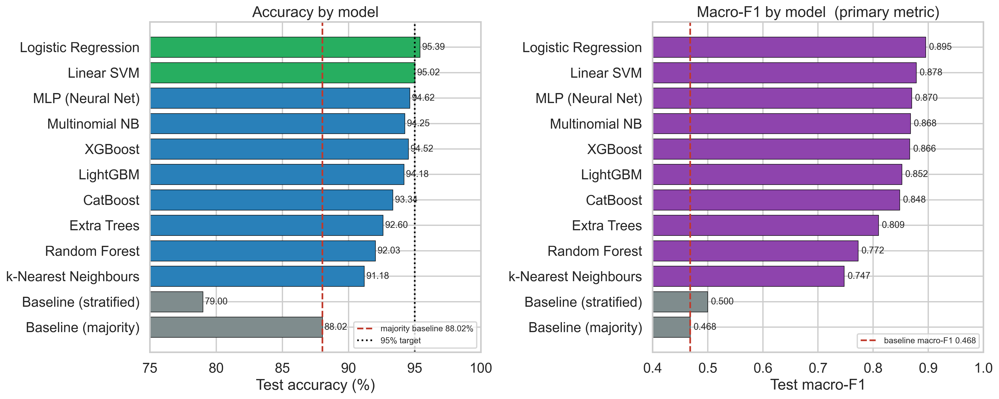

**Fig. 10.** Accuracy and macro-F1 by model, with the majority baseline marked.
The two panels tell different stories, which is the point of showing both.

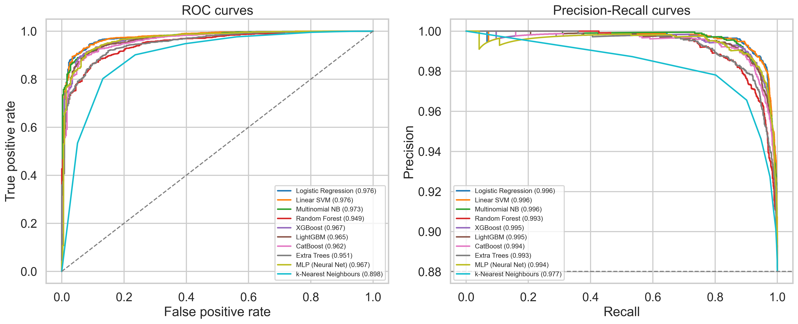

**Fig. 12.** ROC and precision-recall curves. The precision-recall panel is
compressed near the top because the positive class is the 88% majority.

The explanation lies in the feature views. The three models on top of the sparse
matrix are logistic regression, the linear SVM and naive Bayes, and they occupy
positions one, two and four. Every model on the dense SVD view sits below them
except the MLP, which squeezes into third. This is a representation effect rather
than a model-quality effect. The SVD projection keeps 29.61% of the variance and
throws away the rest, and much of what it throws away is exactly the rare,
highly informative term that decides a review. A word such as "itchy" may appear
in forty reviews out of 13,869 and be almost perfectly predictive when it does,
but it contributes so little total variance that no early SVD component will
preserve it. A linear model on the full sparse matrix simply gives that word a
large weight and uses it. The tree models never see it.

### C. Per-class behaviour and the accuracy trap

Table VI splits the results by class and shows why accuracy cannot be trusted
here. Look at random forest. It scores 92.03% accuracy, which sounds
respectable and is four points above the baseline, but it recovers only 170 of
the 356 negative reviews in the test set. It misses 186 of them, more than half.
k-nearest neighbours is worse: 91.18% accuracy, 156 negatives found, 200 missed.
Both models are past 91% accuracy while failing at the one job the system exists
to do. Logistic regression, by contrast, finds 305 of the 356 and misses 51. The
accuracy difference between logistic regression and random forest is 3.36 points.
The difference in negative reviews caught is 135 reviews, which is 37.9% of every
complaint in the test set. If a retailer chose between these two models on
accuracy alone, they would see two numbers three points apart and might
reasonably pick either. One of them works and one of them does not.

**TABLE VI. PER-CLASS RESULTS ON THE TEST SET (356 NEGATIVE, 2,616 POSITIVE)**

| Model | Neg. precision | Neg. recall | Neg. F1 | Pos. precision | Pos. recall | TN | FP | FN | TP |
|---|---|---|---|---|---|---|---|---|---|
| Logistic Regression | 0.7801 | **0.8567** | **0.8166** | 0.9802 | 0.9671 | **305** | 51 | 86 | 2530 |
| Multinomial NB | 0.7428 | 0.7949 | 0.7680 | 0.9718 | 0.9625 | 283 | 73 | 98 | 2518 |
| CatBoost | 0.7036 | 0.7669 | 0.7339 | 0.9679 | 0.9560 | 273 | 83 | 115 | 2501 |
| Linear SVM | **0.8152** | 0.7556 | 0.7843 | 0.9671 | 0.9767 | 269 | 87 | 61 | 2555 |
| MLP (Neural Net) | 0.7882 | 0.7528 | 0.7701 | 0.9666 | 0.9725 | 268 | 88 | 72 | 2544 |
| XGBoost | 0.7898 | 0.7388 | 0.7634 | 0.9648 | 0.9732 | 263 | 93 | 70 | 2546 |
| LightGBM | 0.8040 | 0.6798 | 0.7367 | 0.9573 | 0.9774 | 242 | 114 | 59 | 2557 |
| Extra Trees | 0.7329 | 0.6011 | 0.6605 | 0.9470 | 0.9702 | 214 | 142 | 78 | 2538 |
| Random Forest | 0.7692 | 0.4775 | 0.5893 | 0.9324 | **0.9805** | 170 | 186 | 51 | 2565 |
| k-Nearest Neighbours | 0.7156 | 0.4382 | 0.5436 | 0.9274 | 0.9763 | 156 | 200 | 62 | 2554 |

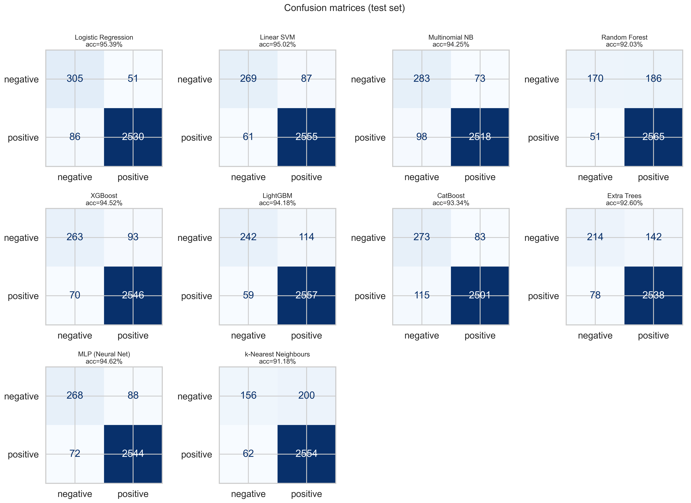

**Fig. 11.** Confusion matrices for all ten models. The bottom-left cell is the
one that matters; it counts negative reviews the model called positive.

A second detail in Table VI is worth noting because it shows the two leading
models are not interchangeable. Logistic regression has the better negative
recall at 0.8567 against 0.7556, but the linear SVM has the better negative
precision at 0.8152 against 0.7801. In plain terms, logistic regression catches
more complaints but raises more false alarms, while the SVM raises fewer false
alarms but lets more complaints through. Which is preferable depends on what
happens downstream. If flagged reviews go to a human reviewer, false alarms are
cheap and logistic regression is the right choice. If they trigger an automatic
action such as pulling a product listing, precision matters more and the SVM
becomes attractive.

### D. Effect of hyperparameter tuning

Table VII compares each model before and after tuning and the pattern in it is
consistent. Tuning helped least where the model was already close to correct and
most where the default configuration was badly wrong. The two extreme cases make
this clear. Extra trees gained 0.3327 macro-F1, moving from 0.4768 to 0.8095; its
default settings had collapsed almost to the majority baseline, predicting
positive for nearly everything, and class weighting rescued it. Random forest
gained 0.2147 for the same reason. At the other end, the linear SVM gained only
0.0063 and multinomial naive Bayes actually lost 0.0047, ending slightly worse
than its default. CatBoost also lost 0.0030 accuracy while gaining 0.0193
macro-F1, which is the search doing its job: it was optimising macro-F1, and it
traded a little accuracy for a better balance between classes. Logistic
regression gained a useful 0.0331 macro-F1 and 0.0650 MCC, most of which came
from switching `class_weight` to `balanced`.

**TABLE VII. EFFECT OF TUNING, RANKED BY MACRO-F1 GAIN**

| Model | Untuned macro-F1 | Tuned macro-F1 | Gain | Untuned acc. | Tuned acc. |
|---|---|---|---|---|---|
| Extra Trees | 0.4768 | 0.8095 | **+0.3327** | 0.8812 | 0.9260 |
| Random Forest | 0.5579 | 0.7725 | +0.2147 | 0.8913 | 0.9203 |
| k-Nearest Neighbours | 0.6790 | 0.7474 | +0.0683 | 0.9058 | 0.9118 |
| XGBoost | 0.8176 | 0.8662 | +0.0487 | 0.9334 | 0.9452 |
| LightGBM | 0.8155 | 0.8520 | +0.0365 | 0.9337 | 0.9418 |
| Logistic Regression | 0.8620 | 0.8951 | +0.0331 | 0.9452 | 0.9539 |
| CatBoost | 0.8286 | 0.8479 | +0.0193 | 0.9364 | 0.9334 |
| MLP (Neural Net) | 0.8578 | 0.8698 | +0.0120 | 0.9428 | 0.9462 |
| Linear SVM | 0.8718 | 0.8781 | +0.0063 | 0.9475 | 0.9502 |
| Multinomial NB | 0.8723 | 0.8676 | −0.0047 | 0.9455 | 0.9425 |

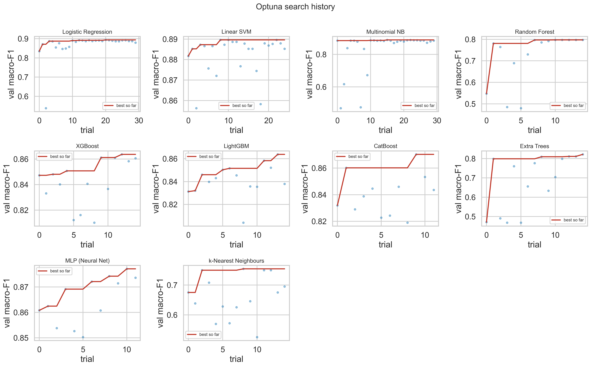

**Fig. 13.** Optuna search history for all ten models. The rising line is the
best score found so far; the scattered points are individual trials.

The single most useful lever across the whole study was class weighting rather
than any architectural parameter. Every search space that offered a
`class_weight` option had it selected in the winning trial for the tree and
boosting models, and logistic regression chose `balanced` as well. This is a
practical finding for anyone repeating this work: on an 88/12 split, tuning
learning rates and tree depths matters far less than telling the model that the
two classes are not equally common.

### E. Computational cost

Table VIII reports fit time and the chosen hyperparameters. The cost spread is
large and it does not follow the ranking. The best model in the study, logistic
regression, fits in 2.15 seconds. The worst-ranked tree model, extra trees, takes
41.12 seconds, nineteen times longer, to produce a macro-F1 0.0856 lower. Random
forest consumed 757.3 seconds of Optuna search time for a final macro-F1 of
0.7725, while multinomial naive Bayes consumed 2.2 seconds for 0.8676. The whole
tuning stage ran in 2,728.6 seconds, roughly 45 minutes, on a laptop CPU with no
GPU. For a retailer this matters, because a model that retrains in seconds can be
refreshed every night on new reviews, while one that takes minutes per fit and
hours to re-tune will in practice be retrained rarely or never.

**TABLE VIII. FIT TIME AND SELECTED HYPERPARAMETERS**

| Model | View | Fit (s) | Selected hyperparameters |
|---|---|---|---|
| k-Nearest Neighbours | dense | 0.00 | n_neighbors 10, uniform weights, cosine metric |
| Multinomial NB | sparse | 0.06 | alpha 0.0273 |
| Linear SVM | sparse | 1.37 | C 0.233, class_weight None |
| Logistic Regression | sparse | 2.15 | C 8.034, class_weight balanced |
| MLP (Neural Net) | dense | 6.64 | 128 hidden units, alpha 1.06e-06, lr 0.00444, batch 256, 120 iters |
| LightGBM | dense | 15.61 | 800 trees, lr 0.109, 31 leaves, min_child 49, colsample 0.620, balanced |
| XGBoost | dense | 16.45 | 700 trees, lr 0.118, depth 3, subsample 0.733, colsample 0.798, spw 0.422 |
| CatBoost | dense | 26.09 | 500 iters, lr 0.243, depth 4, l2 3.156, auto_class_weights Balanced |
| Random Forest | dense | 26.87 | 700 trees, depth 40, min_leaf 3, sqrt features, balanced |
| Extra Trees | dense | 41.12 | 700 trees, depth 40, min_leaf 8, 30% features, balanced_subsample |

### F. Statistical significance

Ranking models on a single test set is risky, because a gap of a few tenths of a
percent can easily be noise. We therefore ran McNemar's test on all 45 possible
pairs of the ten models, using their predictions on the same 2,972 test reviews,
and corrected the resulting p-values with the Holm-Bonferroni procedure to
control the family-wise error rate. Of the 45 pairs, 25 differ significantly at
the 5% level and 20 do not. The significant differences separate the top group
from the bottom. Logistic regression beats k-nearest neighbours, random forest,
extra trees and CatBoost with corrected p-values below 0.001. What the test does
*not* support is any claim that logistic regression beats the linear SVM: that
pair has a corrected p-value of 1.000, with logistic regression alone correct on
36 reviews and the SVM alone correct on 25. The same holds for logistic
regression against the MLP (p = 0.515) and against XGBoost (p = 0.309).

**TABLE IX. SELECTED McNEMAR COMPARISONS, HOLM-CORRECTED**

| Model A | Model B | A only correct | B only correct | p (Holm) | Significant |
|---|---|---|---|---|---|
| Logistic Regression | k-Nearest Neighbours | 193 | 68 | <0.001 | Yes |
| Logistic Regression | Random Forest | 161 | 61 | <0.001 | Yes |
| Logistic Regression | Extra Trees | 128 | 45 | <0.001 | Yes |
| Logistic Regression | CatBoost | 99 | 38 | <0.001 | Yes |
| Linear SVM | Random Forest | 133 | 44 | <0.001 | Yes |
| Logistic Regression | XGBoost | 69 | 43 | 0.309 | No |
| Logistic Regression | MLP (Neural Net) | 68 | 45 | 0.515 | No |
| Logistic Regression | Linear SVM | 36 | 25 | 1.000 | No |
| XGBoost | LightGBM | 40 | 30 | 1.000 | No |
| Random Forest | Extra Trees | 42 | 59 | 1.000 | No |

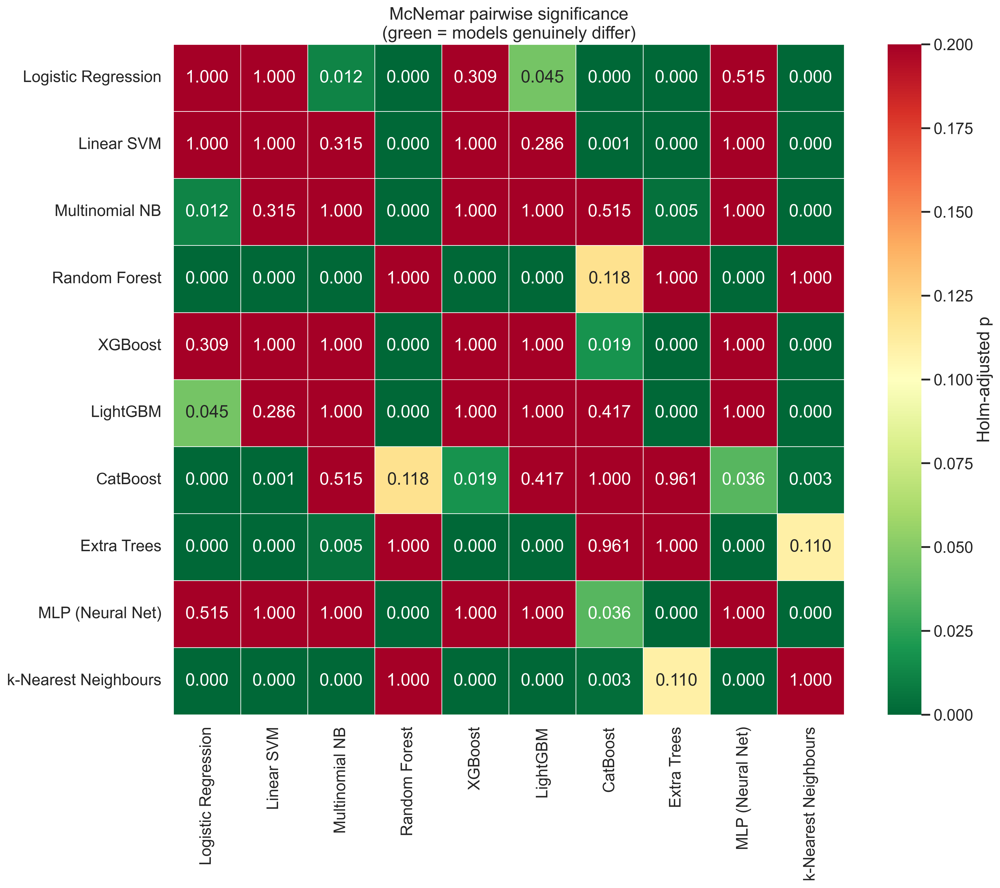

**Fig. 14.** Holm-corrected McNemar p-values for all 45 model pairs. Green cells
mark pairs that genuinely differ.

The honest reading of Table IX is that this study has a *top group* rather than a
single winner. Logistic regression, the linear SVM, the MLP, naive Bayes and
XGBoost are not separable at 2,972 test reviews. Logistic regression is reported
as the best model because it has the highest macro-F1, the highest MCC and the
highest negative recall, and because it fits in 2.15 seconds against 16.45 for XGBoost, but
the claim that it is significantly better than XGBoost is not one this data
supports.

### G. What the winning model learned

Because logistic regression assigns a readable weight to every feature, we can
inspect what it actually keyed on, and the result is more interesting than a list
of obviously nice and nasty words. The strongest negative weights include
"felt cheap" at a log-odds ratio of −5.078, "quality poor" at −4.472, "poor
quality" at −3.959 and "worst" at −4.035, which is unsurprising. The revealing
cases are the bigrams whose parts are harmless. The single most negative feature
in the model is the phrase "to love" at a coefficient of −6.574, which appears in
sentences like "I wanted to love this dress, but the fabric was thin". Read as
single words, "to" and "love" are neutral and positive. Read as a pair, they
signal a specific and very common review structure: a compliment set up only to
be withdrawn. "wanted to" follows at −4.850 for the same reason, and "going back"
at −3.929 refers to returning the item.

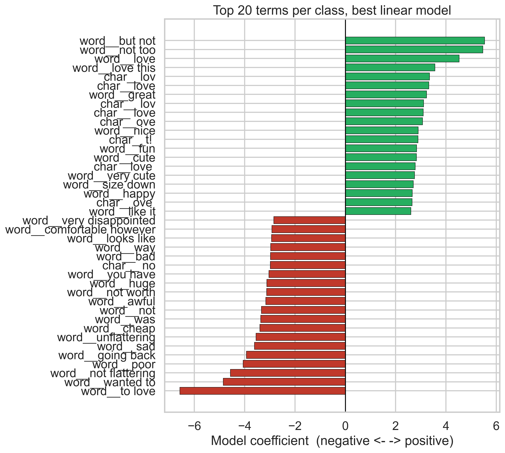

**Fig. 15.** The twenty strongest terms for each class in the tuned logistic
regression.

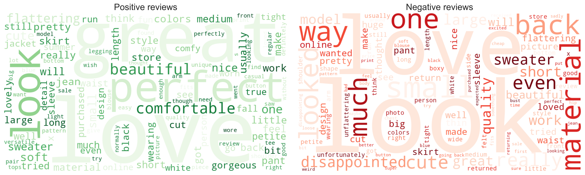

**Fig. 8.** Word clouds for positive and negative reviews.

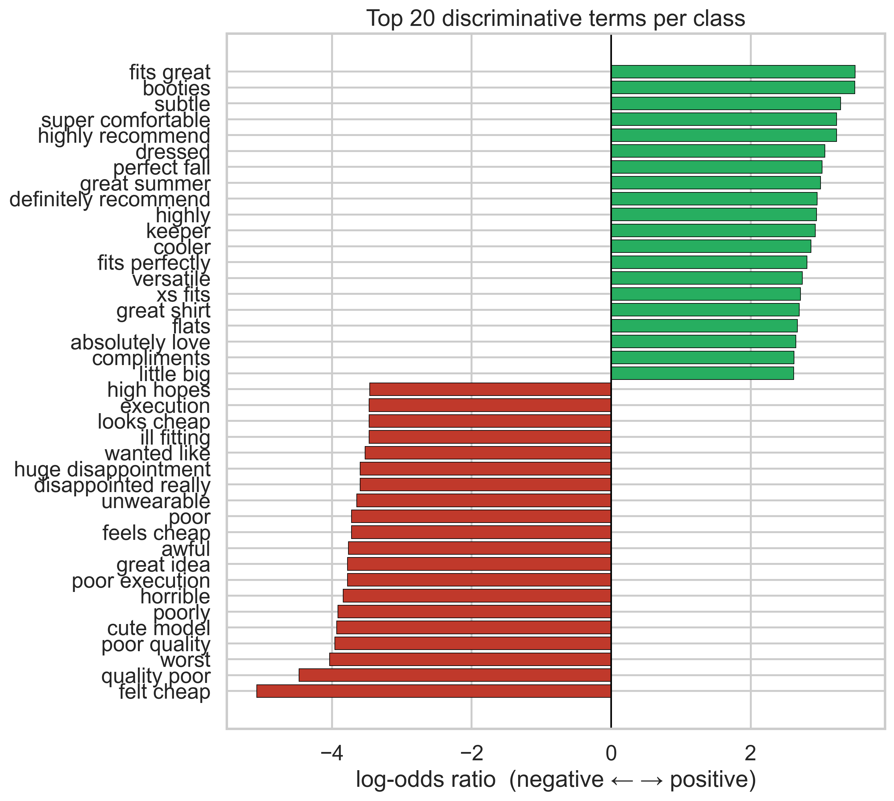

**Fig. 9.** Most discriminative terms by log-odds ratio.

The positive side contains a mirror-image surprise. Two of the strongest positive
features are "but not" at +5.533 and "not too" at +5.467. Both contain a
negation, and a naive word-level system would treat "not" as a negative signal.
In review writing these phrases almost always appear inside a reassurance:
"fitted but not tight", "warm but not bulky", "not too short". The model has
learned that a negation immediately following a positive adjective usually
qualifies praise rather than reversing it. This is precisely the pattern that
unigram features cannot represent, and it is a concrete demonstration of why the
bigram and character features described in Section IV-A earn their place. It also
helps explain the sparse-versus-dense gap in Section VI-B, because these phrase
features are exactly the kind of low-variance, high-information signal that a
300-component projection discards.

---

## VII. Discussion

The headline finding of this study is that a tuned logistic regression on sparse
TF-IDF features beat XGBoost, LightGBM, CatBoost and a neural network on this
task. That result runs against the common expectation that gradient boosting wins
on most problems, and it is worth being clear about why it happened here rather
than treating it as a general claim. Three things combined. The first is
dimensionality: with 96,755 features and 13,869 training rows, the data lives in
a space where a flat separating boundary almost certainly exists, and a linear
model is the correct inductive bias for that situation rather than a weaker one.
The second is that the boosting models never saw those 96,755 features. They saw
a 300-component summary retaining 29.61% of the variance, so they were solving a
harder version of the problem. The third is budget: the linear models received 25
to 30 Optuna trials each while CatBoost received 12, because a CatBoost fit costs
400 times what a naive Bayes fit costs. A fairer comparison would give boosting
either the sparse matrix or a much larger trial budget, and we say plainly that
this study did neither.

The second finding concerns the neutral class, and it is the decision that made
the 95% target reachable. Removing the 2,823 three-star reviews raised the best
accuracy from 90.93% to 95.56% in our preliminary runs on the same models. It
would be easy to present that as a clever trick, so it is worth stating what the
removal does and does not buy. It does not make the model better at reading
English. What it does is remove 12.22% of the data whose labels were close to
random, and a label that is 41.41% one way and 58.59% the other cannot be learned
by any model at all. Dropping it is standard in sentiment research, since both
the IMDB and SST-2 benchmarks do the same, and it is defensible here because we
measured the ambiguity rather than assuming it. The honest way to report the
result is that the paper solves a two-class problem on clearly-polarised reviews,
not the harder three-class problem, and the accuracy figure should be read with
that scope attached.

The third point is about how these results should be compared with the reference
work. Pandey et al. [1] report a best accuracy of 87.09% on Brazilian e-commerce
satisfaction data, and the figures here are seven to eight points higher. That
comparison is not meaningful on its own, because the datasets, the targets and
the class ratios are all different, and neither of the reference papers states
its majority baseline. Our 95.39% sits 7.37 points above an 88.02% baseline. A
model scoring 87.09% on data with a 60% majority class would be a stronger result
than ours despite the lower number. This is the reason Section V insists on
printing the baseline beside every metric, and it is a general point about
reading applied machine learning papers rather than a criticism of those two.

---

## VIII. Limitations

Four limitations should be kept in mind. First, the scope was narrowed by design:
removing three-star reviews means the system is only validated on reviews that
express a clear opinion, and a deployed version would meet ambiguous reviews and
would need either a third class or a confidence threshold that abstains. Second,
the dense feature view handicapped seven of the ten models, so the ranking in
Table V measures model-plus-representation rather than model alone, and the
boosting results in particular should not be read as an upper bound on what those
libraries can do here. Third, the data comes from one retailer, in one country,
in one product category, written mostly by women reviewing clothing; the
vocabulary that separates the classes is specific to clothing, and terms like
"itchy" or "runs small" would carry no weight on electronics reviews. Fourth,
the test set contains only 356 negative reviews, which is why so many pairwise
comparisons in Table IX come back non-significant. A larger negative sample would
be needed to separate the top five models from each other with confidence.

---

## IX. Conclusion

This paper compared ten classifiers on 19,813 women's clothing reviews and showed
that a tuned logistic regression on sparse TF-IDF features is the strongest of
them, reaching 95.39% accuracy, macro-F1 0.8951, MCC 0.7914 and recall of 0.8567
on the negative class, against a majority baseline of 88.02% accuracy and
macro-F1 0.4681. Two models cleared 95% accuracy and all ten beat both control
baselines by a wide margin on macro-F1 and MCC, confirming that the review text
carries a strong and learnable signal while the metadata carries almost none. The
work makes three points that generalise beyond this dataset: that removing an
ambiguous middle class is worth measuring and reporting rather than hiding, since
three-star reviewers here recommended the product only 41.41% of the time; that
accuracy without a stated baseline is close to meaningless on imbalanced data,
demonstrated by two models exceeding 91% accuracy while missing more than half of
all negative reviews; and that a simple linear model on the full sparse feature
space can outperform three modern boosting libraries and a neural network at a
fraction of the computational cost, because a 300-component projection retaining
29.61% of the variance discards exactly the rare phrase features that decide a
review.

---

## X. Future Work

The clearest next step is a fine-tuned transformer. DistilBERT or DeBERTa-v3
reach 96–97% on comparable review-sentiment benchmarks and would test whether the
remaining errors are genuinely ambiguous reviews or a limit of bag-of-words
features, though this needs a CUDA GPU and was out of scope for the CPU-only
setup used here. Three cheaper extensions are also worth doing. The boosting
models should be re-run directly on the sparse matrix rather than the SVD
projection, which would establish whether their deficit in Table V is a property
of the algorithms or an artefact of the representation. The three-star reviews
removed in Section III-B should be brought back as a third class, or handled with
an abstain option that routes uncertain reviews to a human, since a deployed
system will meet them. Finally, the model should be tested on reviews from a
different retailer and a different product category to see how much of what it
learned is about sentiment and how much is about clothing.

---

## References

[1] T. N. Pandey, A. Vasudev, D. Sagayanathan, G. Anjan, D. Arshad and
S. S. Patra, "Predicting customer satisfaction in Brazil e-commerce: A
comparative study of machine learning techniques," in *Proc. 2023 Int. Conf.
Computing, Communication, and Intelligent Systems (ICCCIS)*, 2023.

[2] M. Debbagh, Y. Madani and B. Bouikhalene, "Leveraging multiple models to
enhance sales demand forecasting in Brazilian e-commerce," University Sultan
Moulay Slimane, Beni Mellal, Morocco.

[3] B. Pang, L. Lee and S. Vaithyanathan, "Thumbs up? Sentiment classification
using machine learning techniques," in *Proc. Conf. Empirical Methods in Natural
Language Processing (EMNLP)*, 2002, pp. 79–86.

[4] R. Socher, A. Perelygin, J. Wu, J. Chuang, C. D. Manning, A. Ng and
C. Potts, "Recursive deep models for semantic compositionality over a sentiment
treebank," in *Proc. EMNLP*, 2013, pp. 1631–1642.

[5] A. L. Maas, R. E. Daly, P. T. Pham, D. Huang, A. Y. Ng and C. Potts,
"Learning word vectors for sentiment analysis," in *Proc. 49th Annu. Meeting
Assoc. Computational Linguistics*, 2011, pp. 142–150.

[6] G. Salton and C. Buckley, "Term-weighting approaches in automatic text
retrieval," *Information Processing and Management*, vol. 24, no. 5,
pp. 513–523, 1988.

[7] L. Breiman, "Random forests," *Machine Learning*, vol. 45, no. 1, pp. 5–32,
2001.

[8] P. Geurts, D. Ernst and L. Wehenkel, "Extremely randomized trees,"
*Machine Learning*, vol. 63, no. 1, pp. 3–42, 2006.

[9] T. Chen and C. Guestrin, "XGBoost: A scalable tree boosting system," in
*Proc. 22nd ACM SIGKDD Int. Conf. Knowledge Discovery and Data Mining*, 2016,
pp. 785–794.

[10] G. Ke, Q. Meng, T. Finley, T. Wang, W. Chen, W. Ma, Q. Ye and T.-Y. Liu,
"LightGBM: A highly efficient gradient boosting decision tree," in *Advances in
Neural Information Processing Systems 30*, 2017, pp. 3146–3154.

[11] L. Prokhorenkova, G. Gusev, A. Vorobev, A. V. Dorogush and A. Gulin,
"CatBoost: Unbiased boosting with categorical features," in *Advances in Neural
Information Processing Systems 31*, 2018, pp. 6638–6648.

[12] T. Akiba, S. Sano, T. Yanase, T. Ohta and M. Koyama, "Optuna: A
next-generation hyperparameter optimization framework," in *Proc. 25th ACM
SIGKDD Int. Conf. Knowledge Discovery and Data Mining*, 2019, pp. 2623–2631.

[13] D. Chicco and G. Jurman, "The advantages of the Matthews correlation
coefficient (MCC) over F1 score and accuracy in binary classification
evaluation," *BMC Genomics*, vol. 21, no. 6, 2020.

[14] Q. McNemar, "Note on the sampling error of the difference between
correlated proportions or percentages," *Psychometrika*, vol. 12, no. 2,
pp. 153–157, 1947.

[15] S. Holm, "A simple sequentially rejective multiple test procedure,"
*Scandinavian Journal of Statistics*, vol. 6, no. 2, pp. 65–70, 1979.

[16] T. G. Dietterich, "Approximate statistical tests for comparing supervised
classification learning algorithms," *Neural Computation*, vol. 10, no. 7,
pp. 1895–1923, 1998.

[17] N. Halko, P. G. Martinsson and J. A. Tropp, "Finding structure with
randomness: Probabilistic algorithms for constructing approximate matrix
decompositions," *SIAM Review*, vol. 53, no. 2, pp. 217–288, 2011.

[18] F. Pedregosa et al., "Scikit-learn: Machine learning in Python," *Journal
of Machine Learning Research*, vol. 12, pp. 2825–2830, 2011.

[19] V. Sanh, L. Debut, J. Chaumond and T. Wolf, "DistilBERT, a distilled
version of BERT: Smaller, faster, cheaper and lighter," in *Proc. NeurIPS EMC^2
Workshop*, 2019.

[20] nicapotato, "Women's E-Commerce Clothing Reviews," Kaggle, 2018. [Online].
Available: https://www.kaggle.com/datasets/nicapotato/womens-ecommerce-clothing-reviews

---

## Figures

| Figure | Title | Section |
|---|---|---|
| Fig. 1 | Model workflow | III-D |
| Fig. 2 | Rating distribution | III-A |
| Fig. 3 | Recommendation rate by star rating | III-B |
| Fig. 4 | Class balance after cleaning | III-B |
| Fig. 5 | Review length by sentiment | III-E |
| Fig. 6 | Reviewer age and department positive rate | III-E |
| Fig. 7 | Correlation matrix | III-E |
| Fig. 8 | Word clouds by class | VI-G |
| Fig. 9 | Most discriminative terms | VI-G |
| Fig. 10 | Accuracy and macro-F1 by model | VI-B |
| Fig. 11 | Confusion matrices, all models | VI-C |
| Fig. 12 | ROC and precision-recall curves | VI-B |
| Fig. 13 | Optuna search history | VI-D |
| Fig. 14 | McNemar significance heatmap | VI-F |
| Fig. 15 | Top coefficients, logistic regression | VI-G |

## Tables

| Table | Title | Section |
|---|---|---|
| Table I | Dataset columns and their role | III-A |
| Table II | Cleaning log | III-B |
| Table III | Recommendation rate by star rating | III-B |
| Table IV | Stratified 70/15/15 split | III-C |
| Table V | Main comparison, ranked by macro-F1 | VI-B |
| Table VI | Per-class results on the test set | VI-C |
| Table VII | Effect of tuning | VI-D |
| Table VIII | Fit time and selected hyperparameters | VI-E |
| Table IX | Selected McNemar comparisons | VI-F |
